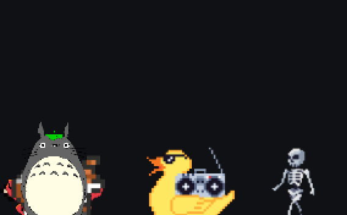

# herdr-pets

The [VS Code Pets](https://github.com/tonybaloney/vscode-pets) animals, living in a
panel of the [Herdr app](https://herdr.dev). Add a dog, a crab or a rubber duck, give
it a name, and it walks, runs, naps and reacts when you point at it.



The pets are decoration. They are not tied to your agents.

## Install

Ask your agent in Herdr to add this repository as a mod. It will copy the folder and
put the panel in your sidebar. To do it by hand:

```sh
cp -R mods/pets ~/.config/herdr-app/mods/pets
```

Then add a block for it to your layout (`~/.config/herdr-app/layouts/<name>.json`).
It sits well in the sidebar column, just above the footer:

```json
{ "id": "pets", "type": "block", "content": { "mod": "pets" }, "size": { "px": 110 } }
```

The mod does not dock itself: a panel Herdr docks on its own becomes a full-height
column, which is far more room than a few pets need. Give the block 160 px or more
if you want the cat, Totoro and the squirrel to climb the wall.

**What it does on your machine.** To get the sprites, the mod reads your editors'
extension folders (`~/.vscode/extensions`, `~/.vscode-insiders/extensions`,
`~/.cursor/extensions`, `~/.vscode-oss/extensions`) looking for VS Code Pets. For any
file it does not find there (every file, if the extension isn't installed) it runs
`curl` to download it from `raw.githubusercontent.com/tonybaloney/vscode-pets`. It
runs no other program. Sprites are cached in `~/.config/herdr-app/data/pets/`.

## Use

- **+** (top right of the panel) adds a pet: pick the animal, a colour and a name.
- **Point at a pet** and it reacts.
- **Right-click a pet** to rename or remove it.
- **Right-click the ground** to add a pet, pick a theme (forest, castle, beach,
  winter, autumn, library), pick a size (nano, small, medium, large) or remove all.
- For keys, bind any of `pets.spawn`, `pets.remove-all`, `pets.size-<nano|small|medium|large>`
  and `pets.theme-<none|forest|castle|beach|winter|autumn|library>` in
  `~/.config/herdr-app/keys.json`. The same commands work from a shell:
  `herdr-app do pets.size-small`.

Up to 20 pets. Your pets, the size and the theme are remembered. Pets start at
medium (55 px).

The first time you add a big pet (Totoro, the grey raccoon) it takes several seconds:
its mirrored sprites are made on your machine, in small steps so Herdr stays responsive.

## Where the art comes from

This repository contains code only. The sprites belong to the artists credited in
[NOTICE](NOTICE) and are never copied here.

- With VS Code Pets installed in VS Code, VS Code Insiders, Cursor or VSCodium, all
  27 pets are available.
- Without it, 23 pets are downloaded from the VS Code Pets repository on demand.
  Cat, frog, bunny and squirrel are not in that repository, so they need the
  extension installed.

Herdr cannot mirror an image, so the mod writes a left-facing copy of each sprite
into its cache. Those copies stay on your machine.

## Not in this version

Throwing the ball, pets chasing each other, snow/leaves/stars, roll call, and
export/import of the pet list.

## Develop

```sh
npm test                     # node --test, no Herdr needed; Node 22 or newer
herdr-app check mods/pets
scripts/sync-to-herdr.sh     # copy the mod into Herdr to try it live
```

Herdr reloads a mod when a file inside its own `mods/` folder changes. It does not
follow a symlink out of that folder, so work in the repo and sync.

`mods/pets/pets.js` is generated. To rebuild it for a new VS Code Pets release:

```sh
git clone --depth 1 --branch <tag> --filter=blob:none --sparse https://github.com/tonybaloney/vscode-pets.git /tmp/vscode-pets
git -C /tmp/vscode-pets sparse-checkout set src
node scripts/gen-pets.mjs /tmp/vscode-pets/src <tag>
npm test
```

## Credits and licence

A port of VS Code Pets by Anthony Shaw and its contributors. Code is MIT
([LICENSE](LICENSE)); upstream's notice and the artists' credits are in
[NOTICE](NOTICE).
