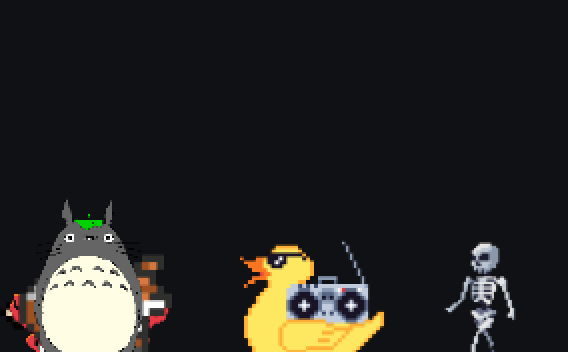

# Pets

A small sidebar panel where the VS Code Pets animals live. The person adds pets with a +
button, each with an animal, a colour and a name. Pets idle, walk, run, lie down and
(cat, totoro, squirrel) climb the left wall, each following its own sequence from VS
Code Pets. They are decoration and know nothing about agents.

## What you see

- One block in the sidebar column, just above its footer, 110 px high and as wide as
  the sidebar: `{ "id": "pets", "type": "block", "content": { "mod": "pets" }, "size": { "px": 110 } }`.
  `mod.json` is `{ "place": "none", "title": "Pets" }`: the mod does not dock itself,
  because a self-docked mod becomes a full-height column. Background `theme().chrome`.
- Pets stand on the bottom edge, or on the theme's ground line. Each is its animated
  GIF, drawn inside a square box and never enlarged: nano 30 px, small 40, medium 55,
  large 110. Default medium.
- A muted `+` (20 px, `theme().muted`) at top 6, right 8.
- With no pets, centred `theme().dim` 12 px text: "No pets yet. Click + to add one."
- With a theme (forest, castle, beach, winter, autumn, library) its background picture
  repeats along the bottom edge behind the pets and its foreground picture in front.
  Default: none.
- A pet whose sprites have not loaded shows as its emoji and stands still.

## How it behaves

- Pets ignore agent status entirely.
- Each pet starts in its start state and, when a state ends, picks the next at random
  from that state's list (repeats in a list are weights).
- Idle and lie hold 5 s, stand 6 s. Walk glides to the edge it faces: left edge 0,
  right edge 95% of the width less the sprite. Speed is the pet's speed (0 to 5) x 10
  px/s, x 0.7 to 1.3 chosen once per pet; run is 1.6 x. A speed-0 pet (rocky) holds.
- Wall: climb to 100 px at 10 px/s, hang 5 s, jump down at 50 px/s, land 1 s. The
  squirrel climbs to 30-80% of the panel height at 55 px/s and falls at 150 px/s. A
  panel too short to climb never picks the wall.
- Pointer over a pet on the ground: it stops where it is, plays `swipe` for 1.5 s with
  a bubble above it (👋; finley "Hi! 👋", horse "Neigh!", skeleton ☠️/🎃/🏴‍☠️ by colour,
  squirrel a random food), then resumes the state it was in.
- Click `+`: a dialog (420 x 540) with a search field, the 27 animals (emoji and
  name), the chosen animal's colours, a name field pre-filled with a random name, and
  Cancel / Add. Add fetches the sprites first; if that fails the pet is not added and
  a notification says why. At 20 pets the dialog says so and hides Add.
- Right-click a pet: popup with "<name> the <animal>", Rename… (a dialog), Remove.
- Right-click the ground: popup with Add pet…, Theme (7, the current one ticked), Size
  (4, ticked), Remove all.
- Commands `pets.spawn` (opens the dialog), `pets.remove-all`, `pets.size-<name>` and
  `pets.theme-<name>`. No keys are shipped.
- Pets, size and theme are saved; positions are not. After a restart pets start at a
  random spot.

## Built from

- `mods/pets/`: `main.js` (panel view; with `props().role` it is one of the dialogs),
  `dialogs.js` (picker, rename, menu), `roster.js` (keeps the pets on screen in step
  with the saved list and says what to draw; pure), `engine.js` (states to legs; pure),
  `pets.js` (generated tables for 27 pets from VS Code Pets 1.37.0), `store.js` (saved
  state; pure), `sources.js` (file names, URLs, sizes; pure), `gif.js` (GIF size and
  mirror; pure), `artcore.js` (fetch and cache, given its file and program access; pure)
  and `art.js` (hands `artcore.js` Herdr's `exec`, `fs/promises`, `home`, `appHome`).
- A **leg** is `{ state, sprite, face, fromX, toX, fromY, toY, start, duration, bubble }`.
  Each pet is an absolutely positioned `div`, one size-box high, at the leg's end, with
  its picture standing on the bottom of that box. `.transition("left", …)` gets the time
  left in the leg when the leg moves sideways and `.transition("top", …)` when it moves
  up or down; the other axis gets 150 ms.
- `cx.timer.every(200)` checks for finished legs and calls `cx.notify()` only when a
  pet starts a new one.
- `herdr`: `shared("pets")` / `setShared("pets", { pets: [{ id, type, color, name }], size, theme })`,
  `openOverlay` (dialog and popup of this same mod), `closeOverlay`, `notify`,
  `nextCommand`, `theme`, `settings` (`zoom`, `dark`), `props`, `exec`, `home`,
  `appHome`; `fs/promises` for binary read and write.
- Art: none shipped. `artcore.js` copies `<colour>_<state>_8fps.gif` from the newest
  `tonybaloney.vscode-pets-*` across `~/.vscode/extensions`,
  `~/.vscode-insiders/extensions`, `~/.cursor/extensions` and `~/.vscode-oss/extensions`.
  For a file not found there it runs
  `curl -sL --proto =https --retry 2 --connect-timeout 10 --max-time 20 --max-filesize 20000000 -o <side file> -w %{http_code}`
  against `https://raw.githubusercontent.com/tonybaloney/vscode-pets/1.37.0/media/`:
  200 is kept, 404 means the pet has no such animation, anything else is an error.
  Files go to `~/.config/herdr-app/data/pets/<type>/`, each with a mirrored `.left.gif`
  written by `gif.js`, and a `<colour>.json` listing them. Theme pictures:
  `backgrounds/<theme>/{background,foreground}-{dark,light}-<size>.png`.
- It reads those extension folders, runs `curl` (for any file the installed extension
  does not have; for every file without the extension) and reaches
  `raw.githubusercontent.com`. Tell the person before adding it.

## Watch out

- There is no flip or mirror in the UI kit. Left-facing sprites must be files.
- Herdr stops a script that runs about half a second without a break (400 ms passes,
  800 ms is stopped), and `try`/`catch` does not see it. Mirroring a big sprite
  (Totoro's is 27 frames of 600 x 396) takes seconds. So `gif.js` works in steps of
  16384 pixels, about 5 ms each, and `artcore.js` awaits a real host call
  (`fs.exists`) between them at least every 25 ms. Without this the load dies silently
  and the dialog says "Fetching…" for ever.
- A load that has said nothing for two minutes is started again.
- Herdr reloads a mod only when a file inside its own `mods/` folder changes. A
  symlinked mod folder keeps running the old code.
- The panel is 110 px high. Climbing needs the climb height (100 px) plus the pet's
  height: about 160 px at medium. In a shorter panel pets never pick the wall.
- A mod's `fetch` returns only text or JSON, so binary downloads need `curl`.
- Cat, frog, bunny and squirrel are not in the VS Code Pets GitHub repository. Without
  the extension they are greyed out in the dialog and cannot be added.
- The dog art is CC BY-ND: keep its files unmodified apart from the cached mirror, and
  never commit any sprite.
- Sizes from `on_size_change` are zoomed px; divide by `settings().zoom`.
- Colours with a space (`socks black`) use an underscore in file names.
- Not every pet has every animation (there may be no `swipe` file). A missing one
  falls back to idle, then walk.
- Give the transition the time left in the leg, not its full length, so a redraw
  part-way through cannot slow the pet.
- A pet's animations differ in height (a dog lying down is shorter than one sitting).
  Keep the pet's element one box high and stand the picture on its bottom, or the pet
  sinks into the ground or floats when it changes animation.
- Every copy of the mod shares its modules, and Herdr stops a closed dialog's work
  part-way. Never make one load wait on another's promise: it may never settle. Each
  load downloads into a side file of its own and puts only whole files in place.
- Treat downloaded bytes as untrusted: a GIF with a bad code or a picture claiming
  width 0 must be rejected, because a loop on Herdr's thread freezes the window.
- Pets stand on a theme's ground only once its picture has loaded.
- The overlays open `mod: "pets"`. If the folder is renamed on install, change `MOD`
  in `dialogs.js` and `DATA_REL` in `artcore.js`.
- No ball, no pets chasing each other, no falling snow/leaves/stars, no saved positions.

## Done when

- `herdr-app check mods/pets` passes and `npm test` passes.
- `+`, pick dog, Add: a dog appears on the ground and walks to the right edge and back,
  its feet on the ground the whole way, also right after lying down.
- Pointing at it stops it for 1.5 s with a 👋 above it, then it carries on.
- A cat climbs the left wall, hangs and jumps down in a panel 160 px or taller.
- Adding Totoro shows "Fetching…" for some seconds, the window stays responsive, and
  Totoro appears.
- `herdr-app do pets.size-small` makes every pet smaller at once.
- Right-click the ground, Theme, Forest: the forest appears and pets stand on its ground.
- Right-click a pet, Rename…, type a name, Enter: the menu header shows the new name.
- Quit and reopen Herdr: the same pets, size and theme are there.
- With no VS Code Pets extension, cat is greyed out and dog still downloads.
